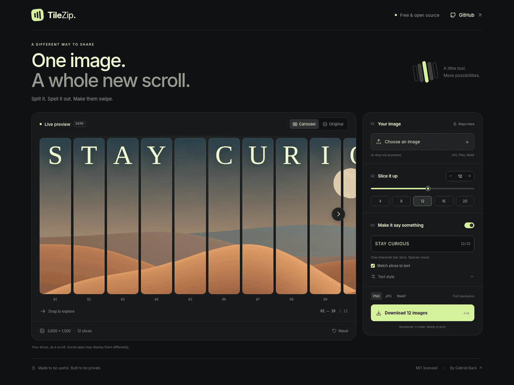
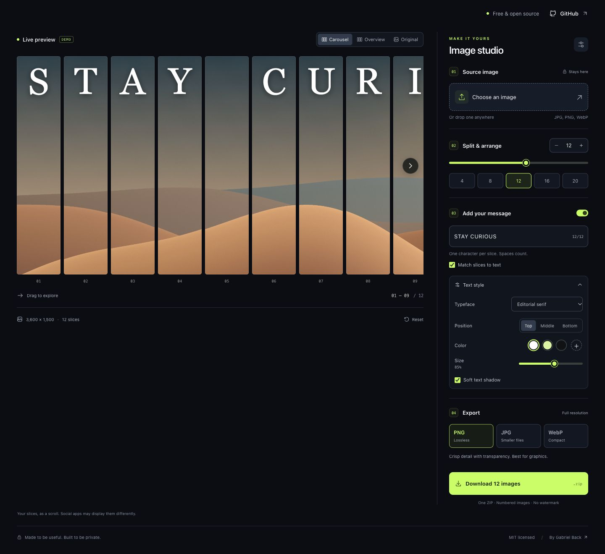
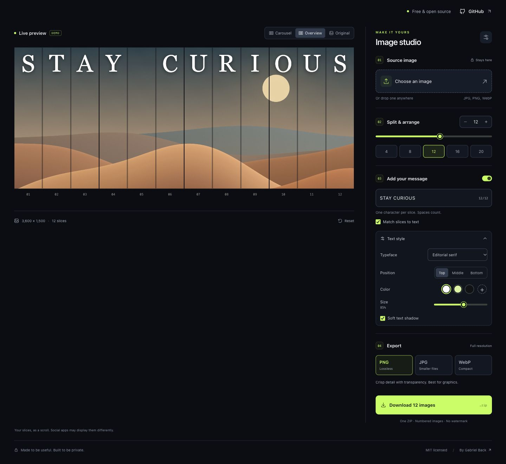
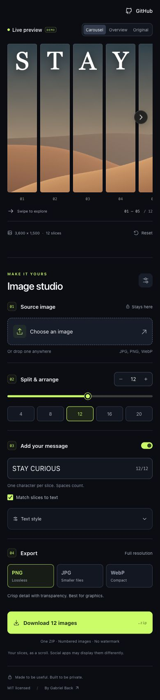

<p align="center">
  
</p>

<h1 align="center">One image. A whole new scroll.</h1>

<p align="center">
  Turn a single image into a seamless horizontal carousel.<br>
  Add a character to every slice. Download the whole story in one ZIP.
</p>

<p align="center">
  <a href="https://goprogabriel.github.io/tilezip/"><strong>Open TileZip ↗</strong></a>
  &nbsp; · &nbsp;
  <a href="#get-it-running">Run locally</a>
  &nbsp; · &nbsp;
  <a href="#publish-on-github-pages">Deploy your own</a>
  &nbsp; · &nbsp;
  <a href="LICENSE">MIT license</a>
</p>

<p align="center"><sub>Free forever as open-source software · No accounts · No image uploads · Zero package dependencies</sub></p>

<a href="https://goprogabriel.github.io/tilezip/">
  
</a>

<p align="center"><sub>A recording of the working app. Try it yourself at <a href="https://goprogabriel.github.io/tilezip/">goprogabriel.github.io/tilezip</a>.</sub></p>

## A carousel, not a grid

TileZip cuts your image into **2–20 full-height vertical strips**, ordered from left to right. Choose between three previews: a scrollable **Carousel**, an **Overview** of every slice, and the untouched **Original**.

Drag with your mouse, swipe on your phone, use the arrows, or focus the preview and use your keyboard. **Overview** fits all slices side by side. Switch between **Overview** and **Original** to compare the result: both use the same image size and position, so nothing jumps.

**Upload → choose your slices → add a message → download.**

The included landscape lets you try everything before choosing your own image.

### Make it say something

Type `HELLO WORLD` and enable **Match slices to text**. You get 11 images: ten letters and one blank slice for the space.

```text
 H   E   L   L   O       W   O   R   L   D
01  02  03  04  05  06  07  08  09  10  11
```

Each character is rendered into its own exported image, not just placed over the preview. Spaces stay blank. Danish letters, composed accents and supported emoji are counted as visible characters rather than raw UTF-16 units.

Prefer to choose the number yourself? Pick a preset or use the slider. Shorter messages leave the remaining strips blank. Longer messages are flagged and cannot be exported until they fit; text is never silently discarded.

## Small tool. Thoughtful details.

| Feature | What you get |
| :-- | :-- |
| **Local image input** | Choose, drag and drop, or paste a JPG, PNG or WebP. |
| **Three preview modes** | Scroll through Carousel, see every slice in Overview, or compare the Original at the same size and position. |
| **One character per image** | Optional automatic slice matching, with spaces included. |
| **Image studio controls** | Clear source, slicing, message and export sections with larger buttons and a preview that stays visible on desktop. |
| **Typography and custom colors** | Serif, sans or monospace; top, middle or bottom; preset or custom text colors, percentage size and a soft shadow. |
| **Full-resolution export** | PNG, JPG or WebP, with quality controls for lossy formats. No resizing or watermark. |
| **One clean ZIP** | `01.png`, `02.png`, … in reading order, with a meaningful archive filename. |
| **No missing pixels** | Integer crop boundaries cover the entire image, including widths that do not divide evenly. |
| **Resilient by default** | File validation, size limits, progress, cancellation and a download-again link. |
| **Keyboard and mobile friendly** | Native controls, visible focus, reduced-motion support and a responsive layout. |

<details>
<summary><strong>See the full desktop interface</strong></summary>
<br>

</details>

<details>
<summary><strong>See all slices in Overview</strong></summary>
<br>

</details>

<details>
<summary><strong>See the mobile interface</strong></summary>
<br>

</details>

## Get it running

You need **Node.js 22 or newer** for the included development tools. You do **not** need to install any npm packages.

```bash
git clone https://github.com/Goprogabriel/tilezip.git
cd tilezip
npm run dev
```

Open **http://localhost:4173**.

Or extract the project ZIP, open a terminal in the folder containing `package.json`, and run `npm run dev`.

| Command | Purpose |
| :-- | :-- |
| `npm run dev` | Serve the source locally. |
| `npm test` | Run the dependency-free Node test suite. |
| `npm run check` | Check JavaScript syntax, HTML IDs and required assets. |
| `npm run build` | Copy the publishable site into `dist/`. |
| `npm run preview` | Serve the built site locally. |

Do not open `index.html` directly with `file://`: browser ES modules should be served over HTTP. The included server is a development tool, not a production server.

## Publish on GitHub Pages

**Repository:** [`Goprogabriel/tilezip`](https://github.com/Goprogabriel/tilezip)  
**Use TileZip online:** [**Open TileZip ↗**](https://goprogabriel.github.io/tilezip/)

This repository deploys automatically to GitHub Pages on every push to `main`. To publish your own copy, follow these steps once:

1. Create an **empty public repository** named `tilezip`. Do not initialize it with a second README or license.
2. Put the contents of this project at the repository root. `index.html`, `package.json` and `.github/` must be at the top level, not inside another `tilezip/` directory.
3. In **Settings → Pages → Build and deployment → Source**, select **GitHub Actions**.
4. Push to **`main`**. The included workflow tests the project, builds `dist/` and publishes it. Check **Actions → Deploy to GitHub Pages** for the result.

```bash
git init
git add .
git commit -m "Launch TileZip"
git branch -M main
git remote add origin https://github.com/Goprogabriel/tilezip.git
git push -u origin main
```

Already pushed before enabling Pages? Open **Actions → Deploy to GitHub Pages → Run workflow** after changing the Pages setting.

No API keys, manually configured secrets, database, payment account or custom environment variables are required. The workflow uses GitHub's built-in token and the standard `github-pages` environment.

### Forking or using a different repository name

Every application asset uses a relative path, so the site works at `/`, `/tilezip/` or another repository subpath. During a GitHub Actions build, the script reads the automatically provided `GITHUB_REPOSITORY` value and updates the built site's repository links and social metadata.

Update the links in **this README** and the `repository` / `homepage` fields in `package.json` for your fork. No application code changes are necessary for standard GitHub Pages hosting. For a custom domain, update the canonical and social URLs in `index.html` and adjust the URL calculation in `scripts/build.mjs`.

GitHub documents the one-time setup here: [configuring a publishing source](https://docs.github.com/en/pages/getting-started-with-github-pages/configuring-a-publishing-source-for-your-github-pages-site) and [using custom Pages workflows](https://docs.github.com/en/pages/getting-started-with-github-pages/using-custom-workflows-with-github-pages).

## How it works

This is intentionally a **plain HTML, CSS and JavaScript application**. There is no framework, bundler or dependency chain to keep up to date.

```text
tilezip/
├── index.html                 Accessible editor and page metadata
├── src/
│   ├── app.js                 State, interactions, preview and export flow
│   ├── styles.css             Responsive interface and reduced-motion rules
│   ├── config.js              Repository, demo and safety limits
│   └── lib/
│       ├── slices.js          Exact crop boundaries and filenames
│       ├── text.js            Unicode-aware character segmentation
│       ├── image.js           File validation and local image decoding
│       ├── render.js          Shared preview/export renderer
│       └── zip.js             Dependency-free, tested ZIP writer
├── assets/                    Original demo image, favicon and social card
├── docs/                      Actual screenshots, recorded demo and QA notes
├── scripts/                   Local server, build, checks and demo capture
├── tests/                     Core tests and optional browser checks
└── .github/workflows/         Pull-request checks and main-branch deployment
```

For strip `i`, the source boundaries are:

```js
const left = Math.floor(i * width / count);
const right = Math.floor((i + 1) * width / count);
```

The strip uses `[left, right)` at the full original height. Adjacent strips meet exactly. Some widths can differ by one pixel; that is intentional.

The preview and the export use the same Canvas renderer. Preview gaps, rounded corners, interface numbers and arrows are **not** burned into the files. Your optional message **is**.

The ZIP uses the standard **STORE** method. PNG, JPEG and WebP are already encoded image formats; recompressing them would generally add CPU work for little benefit. CRC32 checksums, UTF-8 filenames and directory offsets are covered by tests. The archive contains images only, in left-to-right order.

## Privacy, limits and compatibility

**Your image stays in your browser.** TileZip makes no upload requests, uses no analytics, loads no third-party scripts or web fonts, and does not store your photos or text in local storage. The hosting provider still receives ordinary requests for the site's static files and may keep standard access logs.

Images are limited to **40 MB**, **32 megapixels** and **16,384 pixels per side** to keep memory use reasonable. Some low-memory devices may need smaller images. Processing yields between slices, and you can cancel an export. Reloading or leaving the page clears the editor; there is no persistent draft storage.

PNG preserves transparency. JPEG uses a white background for transparent pixels. JPEG and the current WebP export setting are lossy; choose PNG for lossless output. Source metadata is not retained. Browsers may apply color management when decoding photos.

Text uses locally available system fonts. Emoji appearance, glyph availability and minor typographic details can vary between devices. The character count remains Unicode-aware; the preview and export on the same device use the same renderer.

The app targets modern desktop and mobile browsers with Canvas, ES modules and Blob downloads. The 18-test Node suite passes. The original release also completed a 38-check Chromium run; the exact scope and limitations are in [QA notes](docs/QA.md). Safari, Firefox and real mobile devices were not validated in that run. If a browser declines the automatic download, use the visible **ZIP ready — download again** link.

**This is a horizontal carousel preview, not an official X renderer.** Social apps may crop, resize, compress or rearrange uploaded images. Their attachment limits and layouts can change. TileZip's 20-image maximum is a product setting, not a guarantee about another platform. Upload the extracted files in numeric filename order and check the destination's preview before posting.

## Testing and contributing

```bash
npm test
npm run check
npm run build
```

The core suite checks cropping, odd image widths, filenames, Unicode, image validation, CRC32, ZIP structure and cancellation.

Optional browser tests require Python, [Playwright](https://playwright.dev/python/) and [Pillow](https://pillow.readthedocs.io/):

```bash
python -m pip install playwright pillow
python -m playwright install chromium
# In a separate terminal: npm run dev
python tests/browser.py
```

For an isolated, network-free browser test, run `python tests/browser.py --embedded`. This embeds the actual local ES modules and assets into a test document; it does not exercise the hosting server's CSP. The production policy is unchanged.

To refresh the demo screenshots and animation, with the development server running:

```bash
python scripts/capture_demo.py
```

See [CONTRIBUTING.md](CONTRIBUTING.md) for the project's small set of conventions. Please keep it fast, private, accessible and uncomplicated.

## License

[MIT](LICENSE). Use it, fork it, improve it, ship it.

The bundled **Desert Study** demo is original procedural artwork included under the same license. The README recording and screenshots show this project's own interface. No third-party photography, font files or user-provided screenshots are distributed.

---

<p align="center">Made by <a href="https://github.com/Goprogabriel">Gabriel Back</a>. A little tool for your next big idea.</p>
